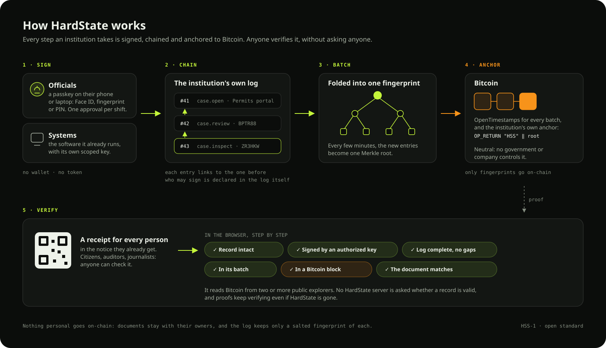

# HardState Standard (HSS-1) and verifier

**Public records that no one can rewrite. Not even the government.**

This repository is the open part of [HardState](https://hardstate.net): the **HardState Standard (HSS-1)**, its
reference implementation and verifier **`@hardstate/core`**, the API contract and the integration guide. It is
everything needed to check a HardState record yourself, without trusting the institution that wrote it or HardState,
and to connect an institution's software to it.

HardState itself (the service at [app.hardstate.net](https://app.hardstate.net) and
[api.hardstate.net](https://api.hardstate.net), its console, interface and brand) is a product of Zevlat
Intelligence and is not in this repository.

## What's here

```
spec/HSS-1.md        The standard: events, signatures, HardState Logs, departments, batches, anchors, proofs.
spec/openapi.yaml    The HardState API contract.
core/                @hardstate/core: JCS (RFC 8785), Merkle (RFC 9162), OpenTimestamps codec, events, logs,
                     WebAuthn and Ed25519 signatures, Bitcoin explorers, proofs, the verifier and an API client.
                     Isomorphic (WebCrypto + fetch).
integration/         How an institution's software records each step and hands the citizen a receipt.
```

## How a record is checked



The verifier never asks a HardState server whether a record is valid. It recomputes every hash, checks every signature
against the keys the institution's own log authorizes, and reads Bitcoin from at least two independent explorers.

## Verify it yourself

**In a browser:** open a receipt, or drop a `.hardstate.json` proof or a document on
https://app.hardstate.net/verify. It runs this code on your machine.

**With `@hardstate/core`:**

```ts
import { HardStateClient } from "./core/src/index.ts";

const hs = new HardStateClient();                      // https://api.hardstate.net, read-only
const verdict = await hs.verify("<event hash>", { withLog: true });
console.log(verdict.status, verdict.steps);            // valid / pending / invalid, and each step
```

`verifyProof(proof)` checks a `.hardstate.json` file without contacting HardState: only Bitcoin explorers are read.

**With the OpenTimestamps client**, without any HardState code:

```bash
pip install opentimestamps-client
curl -o batch.ots https://api.hardstate.net/v1/batches/b-20261020T1542-70fce98d/ots
ots info batch.ots                 # the path from the batch root to BitcoinBlockHeaderAttestation(972355)
ots verify -d 70fce98daf202ea2f09408bffe8f71ea94b7cb41848b11f8106f6d110c41f288 batch.ots
```

**A HardState Anchor by hand:** the transaction's `OP_RETURN` is `6a24` + `48535301` (`"HSS"`, version 1) + the
32-byte root listed by `GET /v1/anchors`:

```bash
curl -s https://mempool.space/api/tx/7c1f42aec5e3e5ad156f24f3ac5a90c3dc772c4503817404b166f391cd2ee9b8 \
  | jq -r '.vout[] | select(.scriptpubkey_type=="op_return") | .scriptpubkey'
# 6a2448535301d06fbda19169ba39742030600090ab61e41b767df7452d9a0160a7cf658a0e47
```

## Adopt it

Institutions register at https://app.hardstate.net/console and connect their own software with the steps in
[`integration/`](integration/README.md) (cURL, Python, Node). Documentation: https://docs.hardstate.net.

## Develop

```bash
npm install
npm test          # JCS and Merkle vectors, OpenTimestamps, logs, sessions, departments, verifier attacks
```

`core/scripts/ots-live.ts` checks the OpenTimestamps code against the real calendars and a 2015 Bitcoin block.

## Security

Found a way to forge, hide or back-date a record? Please report it privately: see [`SECURITY.md`](SECURITY.md).

## License

- Code (`core/`): [Apache-2.0](LICENSE).
- The standard (`spec/`): [CC BY-ND 4.0](spec/LICENSE). Anyone may read, copy, share and implement it; modified
  versions of the text may not be published.
- Neither grants rights to the HardState name, logo or seal. You may say a product "implements HSS-1" or "verifies
  HardState proofs".

---

HardState is a [Zevlat Intelligence](https://zvlint.com) venture.
